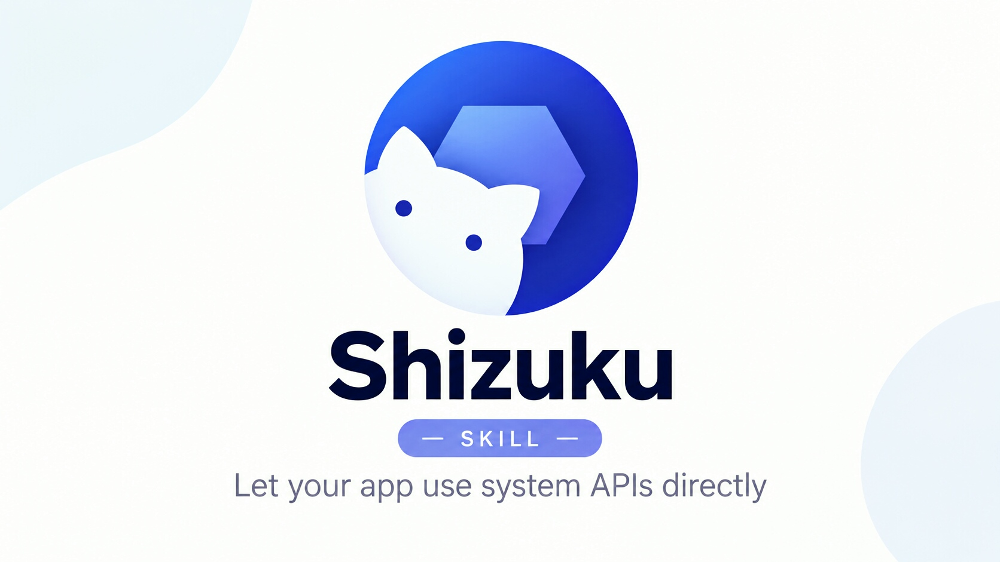

# android-shizuku-skill

A security-testing and device-control skill for AI agents: **operate an Android
phone through Shizuku** — no root required, no adb host required. It runs on the
device itself, from **native Termux** or from a **PRoot / proot-distro Linux
shell**, using the shell identity Shizuku provides.

**Made with fun by Simo** — Telegram: [t.me/syn74x_3rr](https://t.me/syn74x_3rr)

## 🎯 What this skill does

Turns an AI agent into an operator for a Shizuku-enabled Android device. It can:

- **Drive the UI like a real operator** — read the accessibility tree, then
  tap / type / scroll / toggle / launch apps with a strict **read → act →
  confirm** loop. Every step re-reads the screen and gates on the foreground
  app, so taps land on the right element and toggles are verified to flip.
- **Read crash & log evidence for any app** — the crash `logcat` buffer, app exit
  history with reason codes (ANR / crash / OOM / signal / force-stop), dropbox,
  ANR traces and native tombstones.
- **Probe the system from a real shell** — processes & `/proc`, packages,
  permissions & appops, system settings, network state, per-app memory and frame
  stats.
- **Mitigate a known manager crash** — when the Shizuku manager's "start on boot
  (wireless ADB)" preference triggers `ForegroundServiceStartNotAllowedException`
  on every call, one script turns it off, reversibly, through the official UI.
- **Produce verifiable evidence** — screenshots + UI-tree snapshots at each step,
  ready for reports.

## ⚡ Main scripts (name → purpose)

| Script | Purpose |
|---|---|
| `scripts/rish` | Run commands as the Shizuku shell identity (portable launcher) |
| `scripts/rish-bootstrap.sh` | Extract/refresh the bundled rish loader from the manager APK |
| `scripts/shizuku-doctor.sh` | Read-only device/Shizuku health report |
| `scripts/shizuku-disable-selfstart.sh` | Mitigate the manager FGS crash (off / on / status) |
| `scripts/capture-crash.sh` | Collect crash evidence for any package |
| `scripts/screen-probe.sh` | Screenshot + UI-tree evidence snapshot |
| `scripts/ui-dump.sh` | Read the current screen (XML / text / JSON) |
| `scripts/ui-act.sh` | Raw actions: tap, type, keys, swipe, scroll, launch |
| `scripts/ui-wait.sh` | Wait until a text / gone / pkg condition holds |
| `scripts/ui-fast.sh` | Safe step: fresh dump → app gate → resolve → act → verify |
| `scripts/ui-shell.sh` | Persistent session for fast read→act→confirm loops |
| `scripts/ui_parse.py` · `ui_resolve.py` · `ui_toggle.py` · `ui_wait_check.py` | UI-tree parsers & target resolvers |
| `bin/rish` · `bin/rish_shizuku.dex` | Bundled loader, staged into app-private storage at runtime |

Deep docs (architecture, permissions, logs & crashes, UI playbook,
troubleshooting) live in `references/`.

## ⚙️ Requirements & install

- Android with **Shizuku** installed and its server running (wireless debugging,
  adb, or root).
- The terminal app you run from must be authorized in the Shizuku manager.
- No root is required when Shizuku was started via adb/wireless debugging; a
  root-started server gives broader privileges.

Install:

1. Copy this folder into your agent's skills directory (for example
   `~/.config/<agent>/skills/`, `~/.claude/skills/`, `.cursor/skills/`).
2. `chmod 755 scripts/*.sh scripts/rish bin/rish` if the copy lost modes.
3. Run the health check:

   ```sh
   bash scripts/shizuku-doctor.sh
   ```

4. If `bin/rish` / `bin/rish_shizuku.dex` are missing or the loader fails, run:

   ```sh
   bash scripts/rish-bootstrap.sh
   ```

Portable by design: standard `SKILL.md` layout (name + description frontmatter),
bash + Python only, no agent-specific SDK — works with Claude Code, VS Code,
Cursor, Codex, Gemini CLI and any other `SKILL.md`-capable agent. It does not
assume a device model, vendor, uid, screen size, ABI or Android version;
everything is detected at runtime.

## 🔧 Environments

| | Native Termux | PRoot / proot-distro |
|---|---|---|
| `$HOME` | `/data/data/<terminal>/files/home` | container path (e.g. `/home/user`) |
| `$PREFIX` | `/data/data/<terminal>/files/usr` | usually unset |
| Android tools | in `PATH` | `/system/bin` and `/data/...` bind-mounted |
| Loader staging | `/data/data/<terminal>/files/home/.rish-skill` | same Android path |

The bundled `scripts/rish` figures out the terminal package automatically
(env → config file → `/data/data/<pkg>` paths → process ancestry) and stages the
loader where Android 14+ will accept it. Override with
`RISH_APPLICATION_ID=<pkg>` when needed. Details: `references/rish-shell.md`.

## 🛡️ Safety & scope

- Read-only by default; mutating actions (taps, settings, appops) only when a
  task requires them.
- Never change app-ops/permissions of the app hosting your shell — Android kills
  that app's processes (i.e. your session).
- Never run Shizuku calls in parallel (ordered broadcast, ~5 s wait each).
- **Authorized use only** — test only devices and apps you own or are explicitly
  permitted to audit.

## 📄 License & author

MIT — see [LICENSE](LICENSE).
