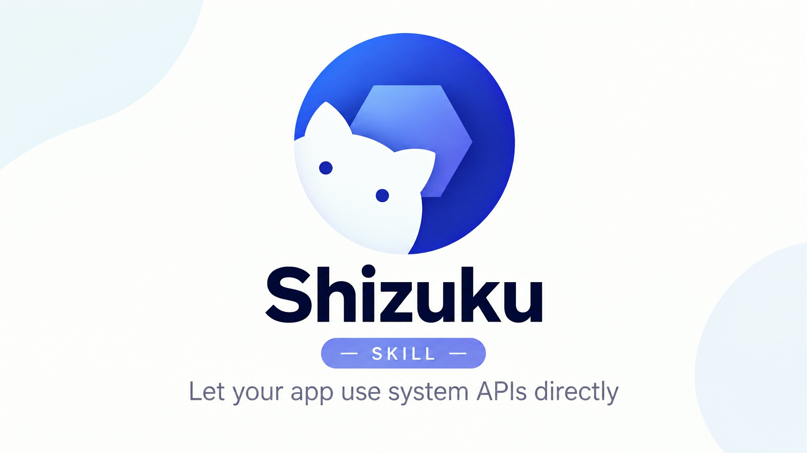

# android-shizuku-skill

A security-testing and device-control skill for AI agents: **full control of a
non‑rooted Android phone via Shizuku** — no root, no adb host. Everything runs
on‑device from Termux as `uid 2000 (shell)`.

**Made with fun by Simo** — Telegram: [t.me/syn74x_3rr](https://t.me/syn74x_3rr)

## 🎯 What this skill does

Turns an AI agent into an operator for a non‑rooted Android device. It can:

- **Drive the UI like a real operator** — read the accessibility tree, then
  tap / type / scroll / toggle / launch apps with a strict **read → act → confirm**
  loop. Every step re‑reads the screen and gates on the foreground app, so taps
  never land on the wrong element and toggles are verified to actually flip.
- **Read crash & log evidence for any app** — crash `logcat` buffer, app exit
  history with reason codes (ANR / crash / OOM / signal / force‑stop), dropbox,
  ANR traces, and native tombstones.
- **Probe the system from a real shell** — processes & `/proc`, packages,
  permissions & appops, system settings, network state, per‑app memory and frame
  stats.
- **Fix a known Android 15 crash** — the Shizuku manager's "start on boot
  (wireless ADB)" preference causes `ForegroundServiceStartNotAllowedException`
  on every call; one script turns it off, reversibly, via the official UI.
- **Produce verifiable evidence** — screenshots + UI‑tree snapshots at each step,
  ready for reports.

## ⚡ Main scripts (name → purpose)

| Script | Purpose |
|---|---|
| `scripts/rish` | Run commands as the system shell (`uid 2000`) through Shizuku |
| `scripts/shizuku-doctor.sh` | Read‑only device/Shizuku health report |
| `scripts/shizuku-disable-selfstart.sh` | Fix the Android 15 manager crash (off / on / status) |
| `scripts/capture-crash.sh` | Collect crash evidence for any package |
| `scripts/screen-probe.sh` | Screenshot + UI tree evidence snapshot |
| `scripts/ui-dump.sh` | Read the current screen (XML / text / JSON) |
| `scripts/ui-act.sh` | Raw actions: tap, type, keys, swipe, scroll, launch |
| `scripts/ui-wait.sh` | Wait until a text / gone / pkg condition holds |
| `scripts/ui-fast.sh` | Safe step: fresh dump → app gate → resolve → act → verify |
| `scripts/ui-shell.sh` | Persistent session for fast read→act→confirm loops |
| `scripts/ui_parse.py` · `ui_resolve.py` · `ui_toggle.py` · `ui_wait_check.py` | UI‑tree parsers & target resolvers |

Deep docs (architecture, permissions, logs & crashes, UI playbook,
troubleshooting) live in `references/`.

## ⚙️ Requirements & install

- Non‑rooted Android with **Shizuku** running (wireless debugging, adb, or root)
  and a terminal app with the `rish` loader from the Shizuku **Shell** page
  (the loader ships inside the Shizuku APK itself — nothing to bundle here).
- Copy the folder into your agent's skills directory (e.g.
  `~/.claude/skills/`, `.cursor/skills/`, `~/.config/<your-agent>/skills/`),
  replace the `<SKILL_DIR>` placeholder in the docs, and the agent can use it.

Portable by design: standard `SKILL.md` layout (name + description frontmatter),
bash + Python only, no agent‑specific SDK — works with Claude Code, VS Code,
Cursor, Codex, Gemini CLI and any other `SKILL.md`‑capable agent.

## 🛡️ Safety & scope

- Read‑only by default; mutating actions (taps, settings, appops) only when a
  task requires them.
- Never change app‑ops/permissions of the app hosting your shell — Android
  kills that app's processes (i.e. your session).
- Never run shizuku calls in parallel (ordered broadcast, 5 s wait each).
- **Authorized use only** — test only devices and apps you own or are
  explicitly permitted to audit.

## 📄 License & author

MIT — see [LICENSE](LICENSE).